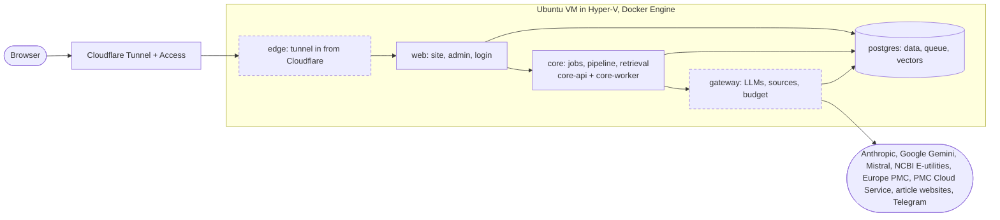

# SuppClaimCheck

Checks claims about dietary supplements against open-access biomedical literature, and shows its working.

> **Status:** Phase 0 (foundations) in progress. Nothing is live yet.

## What it does

1. You paste a claim ("magnesium improves sleep in adults"), an ad, an article link, a screenshot or a podcast transcript.
2. It extracts the claim in a structured form, and **you confirm it** before anything is searched or spent.
3. It searches PubMed and keeps only open-access articles whose licence allows text mining.
4. It finds the most relevant passages, and a language model labels each one as supporting, contradicting or not relevant, with an exact quote.
5. Code checks every quote word for word against the source. Quotes that fail are dropped.
6. Code, not the model, computes the verdict (Supported, Contradicted, Mixed, Insufficient evidence, Not found) and a 0–100 score from a published, versioned rubric.
7. You see the verdict, how the score was built, the quotes with full citations and licences, what was searched, and the limits.

It evaluates claims, not brands or people. It is **not medical advice**.

## Architecture

<!-- map:start: generated by tools/map_build.py from docs/architecture/architecture.yaml. Edit the YAML, not this block. -->


Only `edge` and `gateway` can reach the internet (dashed outline). Everything else runs on an internal network.
<!-- map:end -->

An interactive view of the same map, with what each module does and the path of one claim, is in [docs/architecture/viewer/index.html](docs/architecture/viewer/index.html). Open the file in a browser; it works offline.

## Documentation

| | |
|---|---|
| [Decisions](docs/DECISIONS.md) | Why things are the way they are |
| [Evals](docs/EVALS.md) | How quality is measured, and the results |
| [Runbook](docs/RUNBOOK.md) | What to do when something breaks |
| [Architecture map](docs/architecture/architecture.yaml) | Modules, networks and the path of one claim |
| [Agent rules](AGENTS.md) | How AI agents work on this repo, and what they must never do |

## Working on it

Python tools run through [uv](https://docs.astral.sh/uv/); the private-words hook needs Node. Set up the commit checks once per clone:

```bash
uv sync
uv run pre-commit install
```

Every commit then runs gitleaks, ruff, the whitespace and end-of-file fixers and the private-words check ([D-032](docs/DECISIONS.md)). To run them on every file: `uv run pre-commit run --all-files`.

CI (`.github/workflows/ci.yml`) runs the same hooks on every pull request, plus a gitleaks scan of the whole history, a check that the [architecture map](docs/architecture/architecture.yaml) matches `services/`, a check that nothing under `private/` is tracked, and the tests (`uv run pytest`, `node --test .claude/hooks/hooks.test.mjs`).

## How it is built

Built by its owner ([cg-rt](https://github.com/cg-rt)) with AI-assisted development. The owner scopes, designs, directs, tests and operates it; AI agents (Claude Code) write much of the code under the rules in [AGENTS.md](AGENTS.md), enforced by the hooks in `.claude/`. Project-management notes are kept privately.

## Licence

[MIT](LICENSE). Article text belongs to its authors and publishers: the service quotes short passages with attribution and links to the source, and never redistributes full articles.
